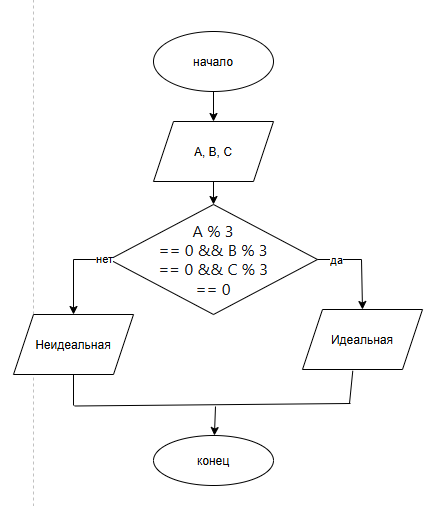

# Домашняя работа №4 (Вариант 16)
  
Студент: Полякова В.Д.
Группа: бТИИ-261

## Задание
Садовод-робот сажает семена в лунки. Лунка считается «идеальной» для посадки, если все три измеренных параметра кислотности почвы (A, B, C) кратны трём. Запишите условие для «идеальной» лунки.

## Блок-схема

